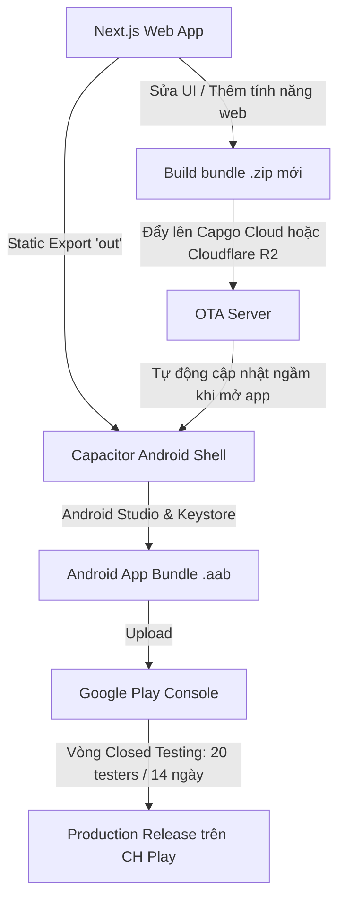

# HƯỚNG DẪN ĐƯA APP LÊN GOOGLE PLAY STORE & TÍCH HỢP CẬP NHẬT TRỰC TIẾP OTA

> **Dự án:** ZenStudy Space (`study_space`)  
> **Kiến trúc:** Next.js (React 19) + Capacitor + Firebase + LiveKit + Cloudflare R2  
> **Mục tiêu:** Đóng gói ứng dụng thành Android App Bundle (`.aab`), nộp lên CH Play và thiết lập cơ chế cập nhật từ xa OTA (Over-The-Air) không cần nộp duyệt lại store ở các phiên bản giao diện tiếp theo.
>
> **Trạng thái (2026-10-28):** tài khoản Google Play Developer **đã có**. Kế hoạch tổng thể và thứ tự ưu tiên: [CHPLAY_LAUNCH_PLAN.md](./CHPLAY_LAUNCH_PLAN.md). Phần policy đã triển khai trước (`/privacy` trên web + link trong app).

---

## 🗺️ TỔNG QUAN LỘ TRÌNH



---

## GIAI ĐOẠN 1: ĐÓNG GÓI NEXT.JS BẰNG CAPACITOR

### 1.1. Cấu hình Static Export cho Next.js
Để mã nguồn HTML, CSS và JavaScript có thể nằm trọn gói bên trong ứng dụng Android:
1. Mở file [next.config.ts](file:///c:/Users/leuti/Desktop/GitHub/Study_Space/next.config.ts) và đảm bảo cấu hình xuất tĩnh:
   ```typescript
   import type { NextConfig } from "next";

   const nextConfig: NextConfig = {
     output: "export", // Bắt buộc để xuất ra thư mục 'out'
     images: {
       unoptimized: true, // App local không dùng được dynamic image optimization của Next server
     },
   };

   export default nextConfig;
   ```
2. Chạy thử lệnh build:
   ```bash
   npm run build
   ```
   *Đảm bảo thư mục `out/` được tạo ra thành công ở thư mục gốc dự án.*

> **Lưu ý với repo hiện tại:** [next.config.ts](../../next.config.ts) chỉ bật `output: "export"` khi có biến `CF_PAGES`, và máy local có `src/app/admin` + `src/app/api` (gitignored) nên `next build` thường sẽ từ chối export. Dùng script `build:mobile` (tạm ẩn 2 thư mục đó khi build) thay vì `npm run build` trần — xem P1 trong [CHPLAY_LAUNCH_PLAN.md](./CHPLAY_LAUNCH_PLAN.md).

---

### 1.2. Cài đặt Capacitor
Cài đặt thư viện lõi và công cụ CLI của Capacitor:
```bash
npm install @capacitor/core @capacitor/cli @capacitor/android
```

Khởi tạo cấu hình Capacitor:
```bash
npx cap init "ZenStudy Space" "space.zenstudy.app" --web-dir out
```
*(Tham số `space.zenstudy.app` là **Package Name / Application ID**, hãy chọn kỹ vì đây là định danh cố định duy nhất trên CH Play).*

File cấu hình [capacitor.config.ts](file:///c:/Users/leuti/Desktop/GitHub/Study_Space/capacitor.config.ts) sẽ được tạo ra:
```typescript
import type { CapacitorConfig } from '@capacitor/cli';

const config: CapacitorConfig = {
  appId: 'space.zenstudy.app',
  appName: 'ZenStudy Space',
  webDir: 'out',
  server: {
    androidScheme: 'https'
  }
};

export default config;
```

---

### 1.3. Khởi tạo thư mục Android
Chạy lệnh tạo thư mục native Android và đồng bộ mã nguồn:
```bash
npx cap add android
npx cap sync
```

---

## GIAI ĐOẠN 2: THIẾT LẬP QUYỀN NATIVE & MÔI TRƯỜNG ANDROID

### 2.1. Khai báo quyền trong `AndroidManifest.xml`
Vì ứng dụng có phòng học trực tuyến LiveKit (Video/Audio) và Firebase Auth, mở file:  
`android/app/src/main/AndroidManifest.xml`

Thêm các quyền sau vào bên trong thẻ `<manifest>` (trước thẻ `<application>`):
```xml
<!-- Quyền kết nối mạng -->
<uses-permission android:name="android.permission.INTERNET" />
<uses-permission android:name="android.permission.ACCESS_NETWORK_STATE" />

<!-- Quyền cho LiveKit (Phòng học tập trung có Audio/Video) -->
<uses-permission android:name="android.permission.CAMERA" />
<uses-permission android:name="android.permission.RECORD_AUDIO" />
<uses-permission android:name="android.permission.MODIFY_AUDIO_SETTINGS" />

<!-- Khai báo phần cứng không bắt buộc để máy không có camera vẫn tải được app -->
<uses-feature android:name="android.hardware.camera" android:required="false" />
<uses-feature android:name="android.hardware.camera.autofocus" android:required="false" />
<uses-feature android:name="android.hardware.microphone" android:required="false" />
```

---

### 2.2. Tạo App Icon & Splash Screen tự động
Sử dụng công cụ chính thức `@capacitor/assets`:
1. Chuẩn bị 2 ảnh gốc chất lượng cao đặt tại thư mục `assets/` (nếu chưa có thì tạo thư mục):
   - `assets/icon.png` (Tối thiểu `1024 x 1024 px`, hình vuông, không bo tròn).
   - `assets/splash.png` (Tối thiểu `2732 x 2732 px`, logo ở giữa).
2. Chạy lệnh sinh tài nguyên tự động cho Android:
   ```bash
   npx @capacitor/assets generate --android
   ```

---

## GIAI ĐOẠN 3: TẠO KHÓA KÝ (KEYSTORE) & BUILD BẢN RELEASE

Google Play bắt buộc gói cài đặt phải được ký bằng một khóa bí mật (Release Keystore) và đóng gói dưới định dạng **Android App Bundle (`.aab`)**.

### 3.1. Tạo Keystore bằng dòng lệnh
Mở PowerShell tại thư mục an toàn (hoặc thư mục gốc dự án, nhưng nhớ thêm `.jks` vào `.gitignore`):
```powershell
keytool -genkey -v -keystore zenstudy-release-key.jks -alias zenstudy-key-alias -keyalg RSA -keysize 2048 -validity 10000
```
*Nhập mật khẩu (ghi nhớ kỹ), họ tên, tổ chức theo hướng dẫn trên màn hình.*

> 🚨 **CẢNH BÁO SỐNG CÒN:**  
> - File `zenstudy-release-key.jks` và mật khẩu phải được sao lưu lên nhiều nơi an toàn (Google Drive, 1Password,...).  
> - Nếu bạn làm mất Keystore, **Google sẽ không cho phép bạn cập nhật bất kỳ bản nâng cấp nào cho ứng dụng này nữa**.

---

### 3.2. Cấu hình ký tự động trong `build.gradle` (Khuyên dùng)
Chỉnh sửa file `android/app/build.gradle`:
```groovy
android {
    ...
    defaultConfig {
        applicationId "space.zenstudy.app"
        minSdkVersion rootProject.ext.minSdkVersion
        targetSdkVersion rootProject.ext.targetSdkVersion
        versionCode 1
        versionName "1.0.0"
    }

    signingConfigs {
        release {
            storeFile file("../../zenstudy-release-key.jks")
            storePassword System.getenv("KEYSTORE_PASSWORD") ?: "MatKhauKeystoreCuaBan"
            keyAlias "zenstudy-key-alias"
            keyPassword System.getenv("KEY_PASSWORD") ?: "MatKhauKeyCuaBan"
        }
    }

    buildTypes {
        release {
            signingConfig signingConfigs.release
            minifyEnabled false
            proguardFiles getDefaultProguardFile('proguard-android.txt'), 'proguard-rules.pro'
        }
    }
}
```

---

### 3.3. Build file Release `.aab`
Chạy lệnh sau từ thư mục `android/`:
```bash
cd android
./gradlew bundleRelease
cd ..
```
*File kết quả nằm tại:*  
`android/app/build/outputs/bundle/release/app-release.aab`

*(Hoặc mở Android Studio: **Build** > **Generate Signed Bundle / APK...** > Chọn **Android App Bundle**).*

---

## GIAI ĐOẠN 4: THIẾT LẬP GOOGLE PLAY CONSOLE & DUYỆT APP

### 4.1. Chuẩn bị tư liệu tiếp thị (Store Listing Assets)
| Tài nguyên | Kích thước | Định dạng | Lưu ý |
|---|---|---|---|
| **App Icon** | `512 x 512 px` | PNG 32-bit (tối đa 1MB) | Không có viền bo tròn sẵn |
| **Feature Graphic** | `1024 x 500 px` | JPG hoặc PNG 24-bit | Banner quảng bá đại diện cho app |
| **Phone Screenshots** | Tối thiểu 2 ảnh, tối đa 8 ảnh | Tỷ lệ 16:9 hoặc 9:16 (ví dụ `1080 x 1920 px`) | Chụp giao diện các phòng học, thẻ lofi, đồng hồ Pomodoro |

---

### 4.2. Khai báo chính sách bắt buộc (Policy & Content)
Vào mục **Policy and programs** > **App content**:
1. **Privacy Policy (Chính sách quyền riêng tư):** Bắt buộc phải có URL công khai (Ví dụ: `https://zenstudy.space/privacy`). Phải giải thích rõ: app sử dụng Microphone/Camera phục vụ tính năng phòng học nhóm và lưu tài khoản qua Firebase.
2. **App Access:** Cung cấp tài khoản test nếu một số tính năng yêu cầu đăng nhập (tạo 1 tài khoản test mẫu với email/password).
3. **Data Safety Form:**
   - Thu thập: User ID, Email (Firebase).
   - Audio/Video: Streaming thời gian thực (LiveKit), không lưu trữ vĩnh viễn trên máy chủ bên thứ ba trái phép.
4. **Target Audience:** Chọn nhóm tuổi phù hợp (thường là 13+ hoặc 18+).

---

### 4.3. VƯỢT QUA CHÍNH SÁCH 20 TESTERS (QUAN TRỌNG NHẤT)
*Áp dụng bắt buộc cho tất cả tài khoản cá nhân (Personal Developer Account) mở sau 11/2023.*

1. **Tạo bản Closed Test:**
   - Vào **Testing** > **Closed testing** > Tạo bản phát hành mới và upload file `app-release.aab`.
2. **Thiết lập danh sách 20 Testers:**
   - Tạo danh sách email người kiểm thử (tối thiểu 20 tài khoản Gmail).
   - Lấy liên kết tham gia kiểm thử (Opt-in link trên Google Play) gửi cho 20 người này.
3. **Quy tắc 14 ngày liên tục:**
   - 20 testers phải bấm nhận link và tải app về máy Android thực tế.
   - App phải được giữ trên thiết bị và mở định kỳ trong **suốt 14 ngày liên tục**.
4. **Xin quyền Production:**
   - Sau khi kết thúc 14 ngày, nút **Apply for production** sẽ mở ra trên Dashboard.
   - Bạn trả lời bảng câu hỏi phản hồi kiểm thử của Google (khoảng 3 câu hỏi về việc tester phản hồi gì, bạn đã sửa lỗi gì).
   - Google phê duyệt trong 3 - 7 ngày và app sẽ chính thức xuất hiện trên CH Play.

---

## GIAI ĐOẠN 5: CẬP NHẬT TRỰC TIẾP OTA (OVER-THE-AIR)

### 5.1. Nguyên lý & Tính hợp lệ
* **Google Play Policy (Mục 4.5 Phân phối):** Cho phép cập nhật mã nguồn script (JavaScript/HTML/CSS) từ xa miễn là **không làm sai lệch hoặc thay đổi danh mục, mục đích cơ bản** của ứng dụng đã được duyệt.
* **Cập nhật được qua OTA:** Giao diện, CSS, logic React, text, sửa bug JS, thêm scene học tập mới.
* **Không cập nhật được qua OTA (Phải build lại `.aab`):** Đổi App icon gốc, đổi quyền trong `AndroidManifest.xml`, thêm plugin native mới.

---

### 5.2. Giải pháp 1: Sử dụng Capgo (Capacitor Updater) — *Chuẩn & Tiết kiệm nhất*
[Capgo](https://capgo.app/) là giải pháp phổ biến nhất cho Capacitor, hỗ trợ rollback tự động nếu bản update bị crash.

#### Bước 1: Cài đặt Plugin
```bash
npm install @capgo/capacitor-updater
npx cap sync
```

#### Bước 2: Khởi tạo trong ứng dụng
Thêm vào file layout gốc hoặc component khởi chạy đầu tiên (ví dụ `src/app/layout.tsx`):
```typescript
import { CapacitorUpdater } from '@capgo/capacitor-updater';
import { Capacitor } from '@capacitor/core';

if (Capacitor.isNativePlatform()) {
  CapacitorUpdater.notifyAppReady(); // Báo cho hệ thống biết phiên bản đang chạy ổn định
}
```

#### Bước 3: Đẩy bản cập nhật OTA khi sửa code
Mỗi khi bạn sửa giao diện hoặc code web, chỉ cần:
```bash
# 1. Build bản web tĩnh mới nhất
npm run build

# 2. Đóng gói thư mục out thành file zip
cd out
zip -r ../update-v1.0.1.zip .
cd ..

# 3. Đẩy lên Capgo Channel qua CLI
npx @capgo/cli bundle upload --channel production --path ./update-v1.0.1.zip
```
*Tất cả người dùng khi mở app sẽ tự động tải bản web mới về mà không cần thao tác gì trên CH Play.*

---

### 5.3. Giải pháp 2: Tự dựng OTA Server với Cloudflare R2 (In-house)
Nếu bạn muốn hoàn toàn làm chủ hạ tầng mà không dùng dịch vụ bên thứ ba:

1. **Upload bản zip lên Cloudflare R2:**
   - Mỗi lần build: nén thư mục `out/` thành `bundle-v1.0.1.zip` và đẩy lên bucket R2 (dự án đã có sẵn lệnh `npm run sync:r2`).
2. **Tạo Endpoint kiểm tra phiên bản trên Cloudflare Worker:**
   ```json
   // GET https://chat-proxy.<worker>.workers.dev/app-version
   {
     "version": "1.0.1",
     "minNativeVersion": "1.0.0",
     "downloadUrl": "https://r2.zenstudy.space/bundles/bundle-v1.0.1.zip",
     "checksum": "sha256-hash-cua-file-zip"
   }
   ```
3. **Cơ chế tải ngầm trong App:**
   - Khi app khởi động, gọi API lấy `version`.
   - Nếu `version` mới hơn phiên bản đang lưu trong `localStorage`:
     - Tải file zip về bộ nhớ máy bằng `@capacitor/filesystem`.
     - Giải nén vào thư mục tài nguyên.
     - Sử dụng API `CapacitorUpdater.set({ id: '1.0.1' })` hoặc reload WebView về đường dẫn local mới.

---

## 📋 CHECKLIST KIỂM TRA TRƯỚC KHI BẤM NỘP APP

- [ ] Lệnh `npm run build` chạy không có lỗi và xuất đủ file vào thư mục `out/`.
- [ ] Đã thêm các quyền `INTERNET`, `CAMERA`, `RECORD_AUDIO` vào `AndroidManifest.xml`.
- [ ] Thử nghiệm micro/camera phòng học trên thiết bị Android thật thông qua LiveKit hoạt động ổn định.
- [ ] File Keystore `.jks` đã được lưu trữ bản sao dự phòng an toàn.
- [ ] File `.aab` được build ở chế độ `release` và đã ký chữ ký số.
- [ ] Đã chuẩn bị đủ 20 testers sẵn sàng cài app trong 14 ngày liên tục.
- [ ] URL Chính sách quyền riêng tư (Privacy Policy) có thể truy cập được từ bên ngoài.
- [ ] Plugin `@capgo/capacitor-updater` đã được tích hợp trong file `.aab` đầu tiên (để sẵn sàng nhận các bản OTA tiếp theo).
