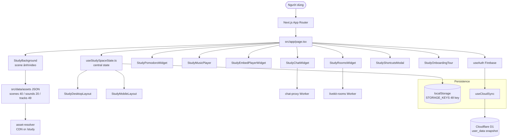
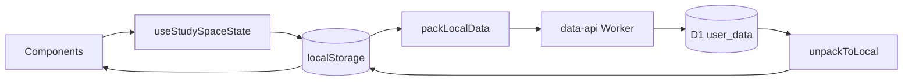
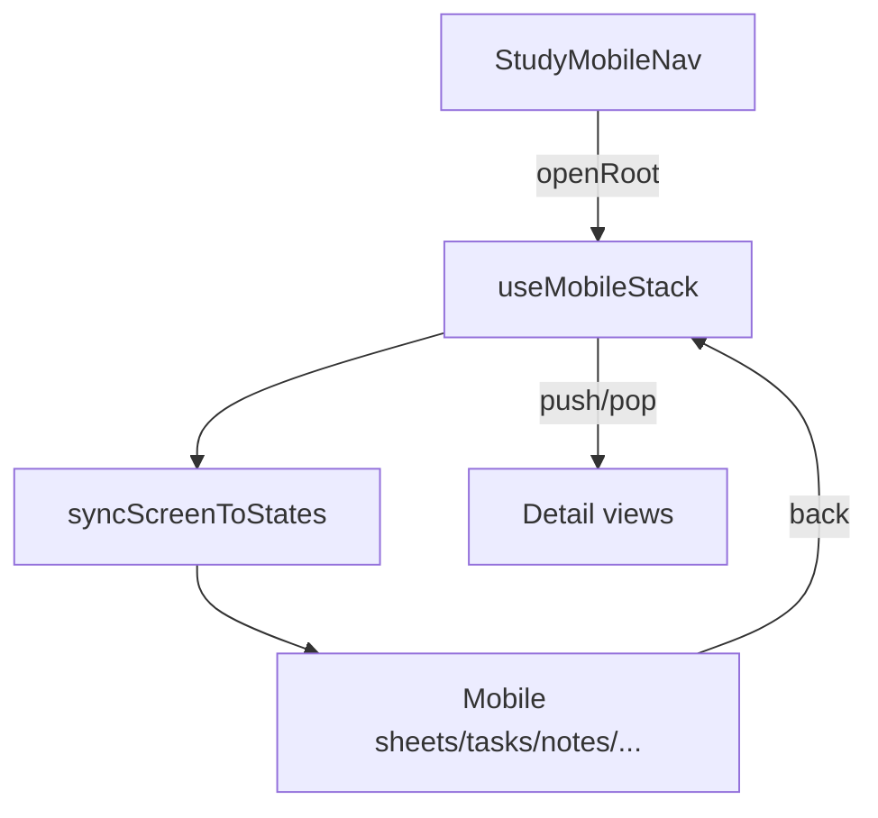

# ZenStudy Space — Tổng quan & chức năng hệ thống

> Tài liệu tổng hợp toàn bộ chức năng website ZenStudy (Study_Space), đi từ tổng quan đến chi tiết, kèm sơ đồ.

## 1. Tổng quan

- **Loại app:** Single-page Next.js 16 + React 19 + Tailwind v4, UI tiếng Việt, local-first (localStorage).
- **Mục đích:** Không gian học tập immersive: bối cảnh 4K, nhạc/âm thanh ambient, Pomodoro/clock/stopwatch, Kanban, ghi chú Markdown, AI chat, phòng học nhóm WebRTC (LiveKit), cloud sync snapshot.
- **Tùy chọn:** Firebase Auth, Cloudflare D1 cloud sync, chat proxy, LiveKit rooms. Thiếu env → chạy local-only.
- **Responsive:** Desktop/mobile tại 640px (`useIsMobile`); mobile dùng stack navigation.

## 2. Sơ đồ kiến trúc tổng

## 3. Chức năng chi tiết

### 3.1 Bối cảnh (Scenes)

- 40 scene (chill 22, anime 6, urban 4, nature 4, dark 2, cute 1, cartoon 1), ảnh/video 4K.
- Slideshow tự động (interval cấu hình), pool = favorites nếu ≥2.
- Yêu thích scene; chọn scene qua palette (Ctrl/Cmd+K) hoặc SceneSelector.
- Preload scene; capsule "Đang tải…".
- Asset URL qua resolver (CDN/R2 hoặc `/study`).

### 3.2 Timer trung tâm (Pomodoro/Clock/Stopwatch)

- Pomodoro với ring progress, durations cấu hình, âm thanh báo.
- Đồng hồ thực + đồng hồ bấm giờ (lap, ms tùy chọn).
- Tab Pomodoro/Clock/Stopwatch; hiển thị/ẩn widget.
- Focus stats (thời gian tập trung theo task).
- Wake Lock khi timer/nhạc/stream chạy (nếu keepAwake).

### 3.3 Tasks (Kanban)

- Nhiều board, cột, thẻ; priority, checklist, due date, pomodoros.
- Card detail modal; focus vào task → mở Pomodoro.
- Lưu localStorage; sync cloud.

### 3.4 Notes

- Nhiều ghi chú, Markdown, checklist, rich text editor.
- Gửi ghi chú sang AI chat; compact sticky note kéo thả/resize.
- Theme notes.

### 3.5 Âm thanh

- Music player lo-fi/jazz/relax (49 track), waveform scrubber, shuffle/loop/volume.
- Ambient mixer 20 sound (rain/indoor/nature) với volume riêng.
- External stream banner khi embed phát nhạc.
- Global mute.

### 3.6 Embed Player (YouTube/Spotify)

- Discovery hub + custom URL; parse YouTube/Spotify/trusted embed.
- PiP mode (kéo/resize), split pane với ResizableDivider.
- Curated presets (Chillhop, Synthwave, Coffee Jazz, Spotify playlists).

### 3.7 AI Chat

- Sessions, markdown, ảnh, IndexedDB media cache.
- Backend failover chain (Workers AI + Groq/OpenRouter/OpenAI/Gemini/custom).
- Quota per-user daily; gửi ghi chú sang chat.
- Mobile sheet + FAB.

### 3.8 Phòng học nhóm (LiveKit)

- Pre-join, host/co-host, lock/password, kick/mute, reactions.
- Room study bar, timer, history, usage stats.
- Mobile room views; active room pill.

### 3.9 Auth & Cloud Sync

- Firebase auth optional; profile pill.
- Cloud sync snapshot (Save Game): packs settings/notes/tasks/focusSessions; debounce 2s; offline recovery; wipe on logout; pull on tab visible.

### 3.10 Mobile UX

- Splash + Welcome screens; mounted-sheet lazy loading.
- Bottom nav (Giờ/Việc/Ghi chú/Nhạc/Thêm); radial bubble menu; double-tap Zen.
- Mobile stack navigation + `syncScreenToStates`.

### 3.11 Chung

- Zen mode, fullscreen, settings (clock, durations, sound, keep awake, tour).
- Shortcuts modal; Command palette (Ctrl/Cmd+K) với scene search.
- Onboarding tour; SEO semantic content/JSON-LD.
- Sync status badge.

### 3.12 Admin (dev-only, NODE_ENV=development)

- `/admin`, `/admin/scenes` (edit scenes.json + media), `/admin/chat`, `/admin/toasts`.
- API routes: admin scenes/sync, livekit token/rooms.
- Hit-limits config.

## 4. Sơ đồ luồng dữ liệu

## 5. Sơ đồ navigation mobile

## 6. Backends (Workers)

| Worker        | Endpoints chính                                                                 |
| ------------- | -------------------------------------------------------------------------------- |
| data-api      | `GET/POST /data`, `/health` (D1 snapshot, 2MB cap, Firebase token)           |
| chat-proxy    | `/chat`, `/models`, `/providers/*`, `/status`, `/health` (quota KV/D1) |
| livekit-rooms | `/token`, `/rooms`, `/usage`, `/history`, moderation routes, webhook     |

## 7. Persistence keys (đại diện)

- Shell: `sceneId`, `globalMute`, `pomoVisible`
- Clock/Pomodoro: `clockSeconds`, `clock12Hour`, `pomoDurations`, `pomoRunningState`, `stopwatchRunningState`
- Music: `mood`, `trackId`, `volume`, `shuffle`, `loop`
- Mixer: `ambientVols`
- Tasks: `kanbanBoards`, `activeBoard`
- Embed: `customEmbeds`, `activeEmbed`, `embedViewMode`, `embedPipPos/Size`
- Notes: `multiNotes`, `oldNotes`, `notesTheme`, `notesCompactPos/Size`
- Rooms: `roomsPos`, `roomsSize`
- Favorites/Slideshow: `favoriteScenes`, `slideshowEnabled`, `slideshowIntervalMin`
- Focus: `activeFocusTask`, `focusSessions`, `focusEpoch`, `pendingFocusQueue`, `lastSyncedAt`
- Tour/Mobile: `tourCompleted`, `mobileWelcomeCompleted`, `mobileSheetZenMap`

## 8. Assets catalog

- Scenes 40 (chill 22, anime 6, urban 4, nature 4, dark 2, cute 1, cartoon 1)
- Sounds 20 (rain 6, indoor 9, nature 5)
- Tracks 49 (lofi 22, jazz 15, relax 12)
- Curated embed presets 5 (YouTube/Spotify)

## 9. Kiểm thử

- 50 test files, ~327 cases (Vitest), bao gồm cloud sync, rooms, chat, mobile, assets, tasks/notes/pomodoro, load test 200 CCU.

---

Tóm lại: ZenStudy là workspace học tập all-in-one, local-first, với lớp tùy chọn auth/cloud/rooms/chat; UI chia desktop/mobile 640px, state trung tâm ở `useStudySpaceState`, dữ liệu qua `STORAGE_KEYS` và snapshot D1.
